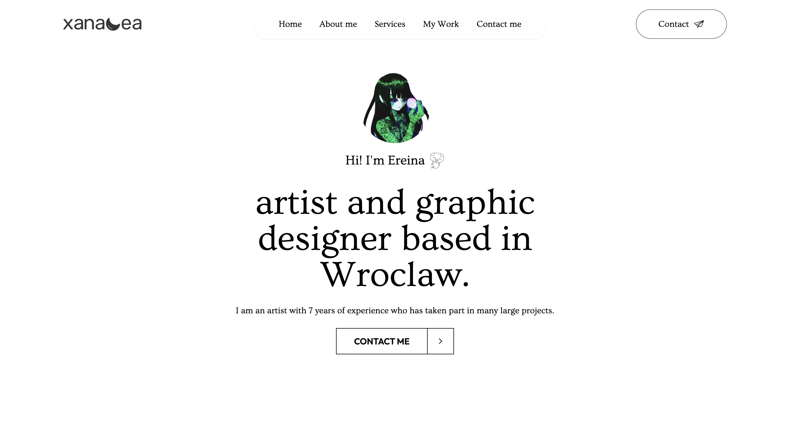

# Сайт-портфолио художника (коммерческий заказ)

Одностраничный сайт-портфолио, разработанный на заказ для художника и графического дизайнера. Сайт представляет автора и его услуги, показывает работы в галерее и позволяет потенциальным клиентам связаться с ним через форму обратной связи.

**Сайт:** [rinkiari.github.io/portfolio](https://rinkiari.github.io/portfolio/)



## Что реализовано

- **Главный экран** с представлением автора и кнопкой перехода к форме связи.
- **Раздел «Обо мне»** с видео и информацией о художнике.
- **Блок услуг** в виде карточек с hover-анимацией.
- **Галерея работ** с адаптивной сеткой и просмотром изображений в модальном окне (закрывается по клику на фон).
- **Форма обратной связи** на базе [Web3Forms](https://web3forms.com/): сообщения отправляются заказчику на почту без собственного бэкенда.
- **Навигация** с плавным скроллом к разделам. При прокрутке шапка становится полупрозрачной с эффектом размытия, на мобильных устройствах открывается боковое меню.
- **Адаптивная вёрстка** от смартфонов до десктопов.
- **Деплой** на GitHub Pages.

## Технологии

- **HTML5**
- **Tailwind CSS** — стилизация и адаптивность, кастомная конфигурация сетки и шрифтов
- **JavaScript** — меню, модальное окно галереи, поведение шапки при скролле
- **Web3Forms API** — отправка формы
- **GitHub Pages** — хостинг

## Структура проекта

```text
├── index.html           # Разметка сайта
├── script.js            # Интерактивность
├── tailwind.config.js   # Настройки Tailwind: сетки и шрифты
└── images/              # Изображения, иконки и видео
```

## Запуск

Сборка не требуется: достаточно открыть `index.html` в браузере или запустить любой локальный сервер, например:

```bash
npx serve .
```

## Автор

Разработка: **Rinkiari**. Дизайн-материалы и изображения работ принадлежат заказчику.
